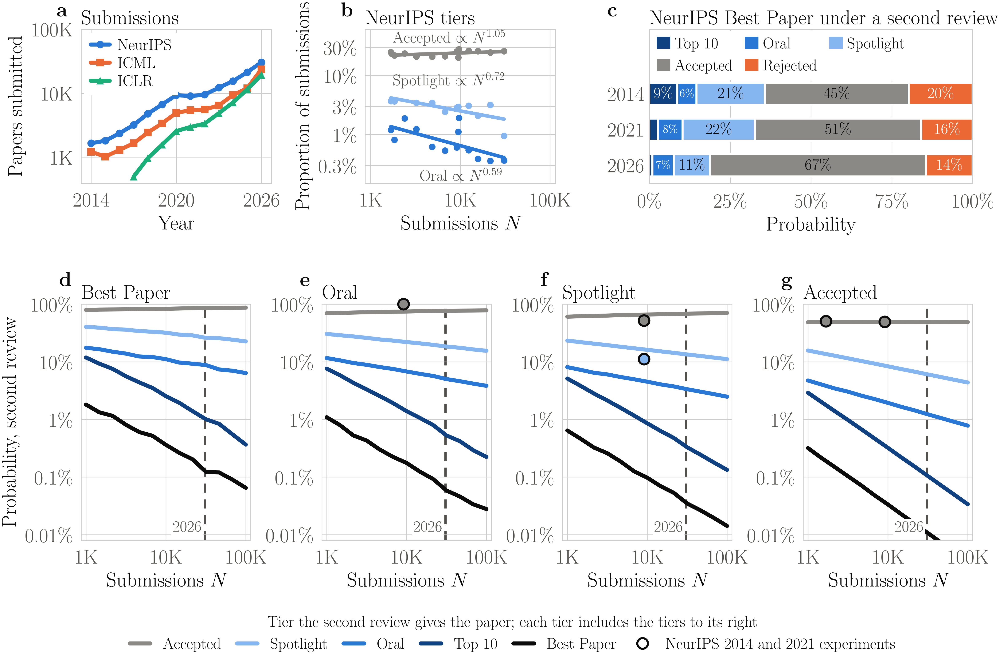

# Scaling Laws of Machine Learning Conference Peer Review

This repository contains the code, data and figures for the paper
**Scaling Laws of Machine Learning Conference Peer Review** (arXiv link coming soon).

Spoiler: acceptance is a coin toss at every conference size, and awards become more of a lottery as conferences grow 🎲




[**Installation**](#installation) | [**Reproducing the Results**](#reproducing-the-results) | [**Repository Layout**](#repository-layout) | [**Terminology**](#terminology) | [**Data**](#data) | [**Citation**](#citation) | [**Contact**](#contact)

## Installation

The project uses Python 3.12 and [uv](https://docs.astral.sh/uv/).

```bash
git clone https://github.com/RylanSchaeffer/Scaling-Laws-of-ML-Conference-Peer-Review.git
```

```bash
cd Scaling-Laws-of-ML-Conference-Peer-Review && uv sync
```

## Reproducing the Results

Every simulated and data table in `results/`, run from the repository root. The first step downloads the ICLR review dumps (about 300 MB) into `data/raw/`:

```bash
WORKERS=5 bash scripts/run_all.sh
```

The closed-form curves:

```bash
uv run python scripts/make_analytic_curves.py && uv run python scripts/make_R_needed.py && uv run python scripts/make_best_paper.py
```

Every figure, into `figures/`:

```bash
uv run python scripts/make_figures.py
```

The unit tests:

```bash
uv run pytest -q
```

## Repository Layout

| Path | Contents |
|---|---|
| `src/peerreview/` | the model of the review process (`model.py`), whole-conference Monte Carlo (`simulate.py`), closed forms (`analytic.py`), calibration to the NeurIPS experiments (`calibrate.py`, `levels.py`), tier definitions and tier sizes (`tiers.py`), and the out-of-sample tests (`validation.py`, `iclr.py`) |
| `scripts/` | one script per result family; `run_all.sh` runs them in order |
| `results/` | one CSV row per configuration, with its parameters, metrics, replicates, seed and wall time |
| `figures/` | every figure, from `scripts/make_figures.py` |
| `data/` | conference counts and their sources (`venues.csv`, `spotlights.csv`, `neurips_best_papers.csv`), the NeurIPS 2014 and 2021 experiments (`experiments.json`), and the NeurIPS 2021 paired reviews with the language-model analysis of the award pairs (`paired_reviews/neurips2021/`) |
| `docs/` | every empirical claim and its source (`claims.md`), metric definitions (`metrics.md`), derivations (`derivations.md`), terminology (`terminology.md`) |
| `REPORT.md` | every finding, in more detail than the paper |
| `tests/` | unit tests |
| `paper/` | the paper's LaTeX source, a submodule of a private repository; it is not needed to run anything |

## Terminology

Every paper gets exactly one tier, like a medal: **Best Papers** (gold), **Oral** (silver),
**Spotlight** (bronze), **Accepted** (accepted with no award) or **Rejected**. No tier contains
another. A tier together with every tier above it is named in full: **Oral or Better**,
**Spotlight or Better**, **Accepted or Better** (every accepted paper). In code and results, a bare
key (`oral`) is the tier and a key ending in `_or_better` is the set. See
[`docs/terminology.md`](docs/terminology.md).

## Data

Conference counts come from the sources listed in [`docs/claims.md`](docs/claims.md). The NeurIPS
2021 paired reviews come from OpenReview, whose reviews and comments are licensed CC BY 4.0; see
[`data/paired_reviews/neurips2021/README.md`](data/paired_reviews/neurips2021/README.md) for their
provenance and the analysis.

## Citation

```bibtex
@article{schaeffer2026scaling,
  title   = {Scaling Laws of Machine Learning Conference Peer Review},
  author  = {Schaeffer, Rylan},
  journal = {arXiv preprint},
  year    = {2026}
}
```

## Contact

Questions, comments and bug reports are welcome: open an issue, or email rschaef@cs.stanford.edu.
